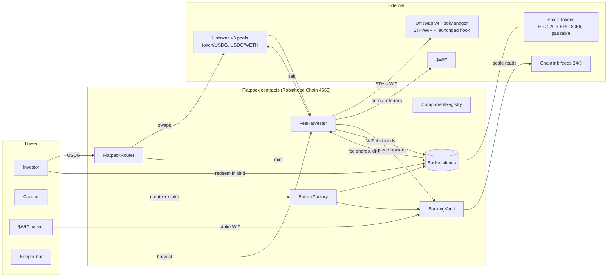
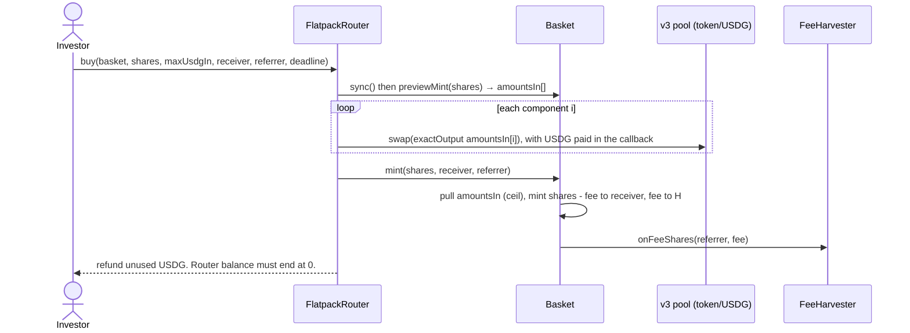

# Flatpack: System Architecture

| | |
|---|---|
| **Status** | Accepted for build, v1.0 (2026-11-05) |
| **Product spec** | [`FLATPACK-PLAN.md`](../../FLATPACK-PLAN.md), §3 and §10 |
| **Decisions** | [`docs/adr/`](../adr/) |
| **Binding interfaces** | `contracts/src/interfaces/*.sol`. **The NatSpec in those files is the normative spec.** Where this document and the interfaces disagree, the interfaces win, and the mismatch is a bug to report. |

---

## 1. Context

Flatpack lets a curator publish an immutable **basket** of Robinhood Chain Stock Tokens as an ERC-20. Investors buy it with USDG in one transaction. Fees and (optionally) stock dividends are converted to **$WIF**. That $WIF is burned or paid to curators, backers, referrers and holders.

## 2. Quality goals (in priority order)

1. **Principal safety.** Holders can always exit in kind. No oracle, keeper, admin or third-party contract other than the Stock Tokens themselves sits on the redeem path.
2. **Correct Stock Token semantics.** ERC-8056 multipliers, pausability, 6-decimal USDG versus 18-decimal tokens.
3. **Every flow ends in $WIF**, with accounting a judge can verify onchain from the events alone.
4. **Small and auditable.** No upgradeability, no periphery-router dependency, custom errors, full NatSpec.
5. **Shippable by Nov 10.** Anything beyond the work packages is out of scope.

## 3. Constraints

- Solidity `0.8.28`, `evm_version = cancun` (Robinhood Chain is Arbitrum Orbit, and Uniswap v4 already relies on transient storage there). **Hardhat 3** (Foundry-compatible Solidity tests, Ignition deployments, viem; ADR-0010). Dependencies come from npm. OpenZeppelin Contracts v5.x and Contracts-Upgradeable v5.x (for clone initialisers).
- **No upgradeable proxies.** Baskets are EIP-1167 clones of an immutable implementation.
- Every address comes from [`config/mainnet-4663.json`](../../config/mainnet-4663.json). Nothing is hardcoded in `src/` except protocol constants.
- Stock Tokens may only be offered outside the US, CA, UK and CH. This is enforced in the app, not the contracts (FLATPACK-PLAN E24 and E25).

## 4. Building blocks

| Contract | Responsibility | State it owns | Who may call privileged functions |
|---|---|---|---|
| `ComponentRegistry` | The allowlist of Stock Tokens a basket may hold, each with its Chainlink feed and Uniswap v3 fee tier. Also stores the benchmark token (SPY). | `token → {enabled, priceFeed, v3Fee}`, `benchmark` | Owner (`Ownable2Step`). **It can't touch funds.** Disabling a component only blocks new baskets and router buys. |
| `BasketFactory` | Validates and deploys baskets as clones. Pulls the curator's $WIF stake into the vault. The source of truth for `isBasket`. | The basket list, `minCuratorStake`, `createPaused` | Owner: `setMinCuratorStake` and `setCreatePaused`. Affects **new** baskets only. |
| `Basket` (clone) | An ERC-20 of fixed-unit, in-kind shares. Charges fees in shares, redeems pro rata, keeps IOUs for paused components, syncs multipliers, skims dividends, and accrues $WIF dividends. | Components, `rawUnits`, `lastMultiplier`, IOUs, the dividend accumulator | Nobody, except the harvester for `notifyWifDividend`. **No owner.** |
| `FlatpackRouter` | USDG → exact-output v3 swaps for each component → `Basket.mint`. Stateless. | None (transient storage only) | Nobody |
| `FeeHarvester` | Receives fee shares and dividend skims, sells them for $WIF via Uniswap v3 and v4, and splits the result into burn, referrers, vault and basket dividends. Tracks referral cycles. | Pending fee shares per basket, referral cycles, pending dividend tokens | `keeper` (harvest timing and `minWifOut`) and owner (`setKeeper`). **Neither can choose where the $WIF goes.** |
| `BackingVault` | $WIF staking per basket, 7-day unstake cooldown, a weekly epoch, the Beat-SPY settlement, and backer and curator reward accounting. | Positions, reward accumulators, queued rewards, NAV snapshots | Factory (`registerBasket`) and harvester (`queueRewards`). `settle` can be called by anyone. |
| `libraries/StockMath` | Rounding helpers, NAV from `rawUnits` × feeds, feed validation | – | – |
| `libraries/UniswapV3Swap` and `UniswapV4Swap` (abstract) | Direct pool swaps with callback authentication | Transient storage holding the expected pool | – |

### 4.1 Trust and authority matrix

| Actor | Can | Cannot |
|---|---|---|
| Owner (deployer EOA, later a multisig) | Add or disable components, set the keeper, set `minCuratorStake`, pause basket *creation* | Move user tokens, change a basket, change fees or splits, block redeem, block withdrawal from the vault |
| Keeper | Choose *when* to harvest and the slippage floor `minWifOut` | Choose the recipients or the split. A malicious keeper's worst case is a bad fill on a single harvest, bounded by the swap math. |
| Curator | Create a basket and stake | Change a basket after creation, or withdraw without the cooldown |
| Chainlink | Decide whether curator and backer rewards are released or burned | Affect principal, mint, redeem or prices of trades |
| Stock Token issuer | Pause a token, which turns redeem legs into IOUs, or blocklist an address | – (out of our control, disclosed) |

## 5. Runtime views (the main flows)

### 5.1 Buy with USDG

### 5.2 Redeem in kind (works with no router, oracle or keeper)
`Basket.redeem(shares, receiver)` runs `sync()`. A fee of 30 bps is transferred as shares to the harvester (the harvester itself is exempt). The net shares are burned, and each component pays `effBal_i × net / supplyBefore` (rounded down). **Each leg is a `try` transfer.** A failed leg increments `owed[receiver][token]` and `totalOwed[token]` and emits `IOURecorded`. `claimIOU(token, to)` pays it out later.

### 5.3 Multiplier sync and dividend skim (`PayInWif` mode)
For each component, read `m = uiMultiplier()`. If `m ≠ last`:
- if `mode == PayInWif` **and** `last < m ≤ last × 1.03`, it's a **cash dividend**. Set `rawUnits_i ← ceil(rawUnits_i × last / m)`, then `excess = effBal_i − ceil(rawUnits_i × supply / 1e18)`. Transfer `excess` to the harvester and call `onDividendSkim(token, excess)`.
- otherwise (a split, reverse split or `Reinvest` mode), make no unit change.
- In every case, `last ← m` and emit `MultiplierSynced`.

The keeper later calls `harvestDividends(basket)`. The harvester sells the skims → USDG → WETH → ETH → $WIF, transfers the $WIF to the basket, and calls `notifyWifDividend(amount)`. Holders get it through a standard reward-per-share accumulator updated in `_update`.

### 5.4 Fee harvest and split
`harvestFees(basket, minWifOut, deadline)` (keeper) redeems **all** pending fee shares (fee-exempt), claims any $WIF dividends those shares accrued, and sells every component → USDG (v3, registry fee tier). It then swaps USDG → WETH (v3, 0.01%), unwraps, and swaps ETH → $WIF (v4 pool key from config, so the hook tax applies). It checks `wifOut ≥ minWifOut`. Then, with `W` = the $WIF produced:
- `toReferrers = W × cycleReferralShares / cycleFeeShares`, claimable per referrer for that cycle
- `burn = W × 50%` sent to `0x…dEaD`
- the rest `R = W − burn − toReferrers` goes to `vault.queueRewards(basket, R × 3/5, R × 2/5)` (backers 30 : curator 20)
- the cycle is closed and `cycle++`.

### 5.5 Weekly settlement (Beat-SPY)
Epochs are fixed 7-day windows anchored at `EPOCH_ANCHOR = 1794016800` (Sat 2026-11-07 02:00 UTC, after the 24/5 stock feeds freeze for the weekend). Once `block.timestamp ≥` the first epoch boundary after `lastSettledAt`, anyone can call `settle(basket)`:
- `navNow = Σ rawUnits_i × price_i` (the **unit-based NAV**: donations can't inflate it, ADR-0007), and `benchNow = price(SPY)`.
- If every feed is valid (answer > 0, `updatedAt` within `MAX_PRICE_AGE = 4 days`) and `navNow/navLast > benchNow/benchLast`, the queued rewards are **released**. Backers go into the accumulator (or are burned if `totalStaked == 0`). The curator share goes to the curator's claimable balance if `curatorActive`, otherwise it's burned.
- Otherwise every queued reward is **burned**.
- Snapshot `navLast ← navNow` and `benchLast ← benchNow`, with `lastSettledAt ← now`.

## 6. Data model and units

| Quantity | Decimals | Notes |
|---|---|---|
| Basket shares | 18 | `1e18` = one share |
| `rawUnits_i` | token raw (18) per `1e18` shares | Required deposit = `ceil(rawUnits_i × shares / 1e18)` |
| USDG | **6** | Never mix units without `StockMath` |
| Stock Token, WETH, $WIF | 18 | |
| Chainlink answer | 8 | Already includes the multiplier. **Never multiply by `uiMultiplier` again.** |
| `uiMultiplier` | 18 | `1e18` = 1.0 |
| NAV in the vault | 18 (USD) | `Σ rawUnits_i × answer_i × 1e10 / 1e18` |
| bps | – | `FEE_BPS = 30`, `REFERRAL_SHARE_BPS = 1000` (of the fee), `BURN_BPS = 5000`, `BACKER_BPS = 3000`, `CURATOR_BPS = 2000` |

## 7. Invariants (these must be invariant tests: `invariant_*` functions in Hardhat Solidity tests)

- **INV-1 Full backing:** for every component, `effBal_i × 1e18 ≥ rawUnits_i × totalSupply`, where `effBal_i = balanceOf(basket) − totalOwed_i`.
- **INV-2 IOU solvency:** `Σ owed[·][t] == totalOwed[t] ≤ t.balanceOf(basket)`.
- **INV-3 Router is stateless:** the router's USDG and component balances are 0 after every external call.
- **INV-4 Fee exactness:** each non-exempt mint or redeem sends exactly `shares × 30 / 10000` shares to the harvester.
- **INV-5 Vault solvency:** the vault's WIF balance ≥ `Σ staked + Σ pendingUnstake + Σ queued + Σ unclaimed rewards`.
- **INV-6 Harvester solvency:** the harvester's WIF balance ≥ unclaimed referral WIF.
- **INV-7 Redeem liveness:** `redeem` never reverts because a *single* component's transfer fails.
- **INV-8 Conservation of $WIF in a harvest:** `burn + toReferrers + toVault == W`, exact to the wei.

## 8. Cross-cutting concepts

- **Reentrancy:** `ReentrancyGuardTransient` on every state-changing external function in Basket, Router, Harvester and Vault. Follow Checks-Effects-Interactions everywhere. Stock Tokens are trusted not to have hooks, but we guard anyway.
- **Token handling:** `SafeERC20` everywhere. Approvals are exact (`forceApprove(x, amount)`), then reset to 0.
- **Callbacks:** a v3 callback must come from the pool stored in transient storage (`tstore` before `swap`, checked and cleared in the callback). A v4 `unlockCallback` must come from the PoolManager, and only while we're inside our own `unlock`.
- **Errors and events:** custom errors only. Every state change emits an event with enough data to rebuild the state offchain (the indexer and judges rely on this).
- **Time:** only `block.timestamp`. Arbitrum's timestamps are sequencer-set and accurate to within minutes, which is fine at weekly granularity.
- **Feed validation (`StockMath.readPrice`):** require `answer > 0`, `updatedAt != 0`, and `block.timestamp − updatedAt ≤ MAX_PRICE_AGE`. There's no sequencer-uptime feed on this chain, which is documented as an accepted risk because the oracle only affects rewards.

## 9. Deployment view

Deploy order (Hardhat Ignition module `contracts/ignition/modules/Flatpack.ts`): `ComponentRegistry` → `FeeHarvester` (keeper = deployer) → `BackingVault` → `Basket` implementation → `BasketFactory` (wired to registry, harvester, vault, $WIF and implementation). The vault and harvester take the factory address through a one-time `setFactory`, guarded so it can only be set once. Then `FlatpackRouter`. Seed the registry from `config/mainnet-4663.json`, and set SPY as the benchmark.

Offchain (later work packages): a keeper cron (TypeScript and viem) for `sync`, `harvestFees`, `harvestDividends` and `settle`; an indexer from events; and a Next.js app.

## 10. Risks and technical debt (accepted for the hackathon)

| Item | Why it's accepted |
|---|---|
| No L2 sequencer-uptime feed | Oracles gate only *rewards*, never principal |
| The keeper is one EOA | It can't redirect funds; worst case is a bad fill on one harvest |
| WIF/ETH liquidity is about $105k, and the launchpad hook takes a cut | `minWifOut` is quoted offchain from a simulation |
| Basket shares could reach restricted persons through secondary transfers | Disclosed. The app is geofenced (E25). |
| Whole-cycle harvests (no partial harvest) | Bounded by keeper cadence. Simplifies referral accounting. |
